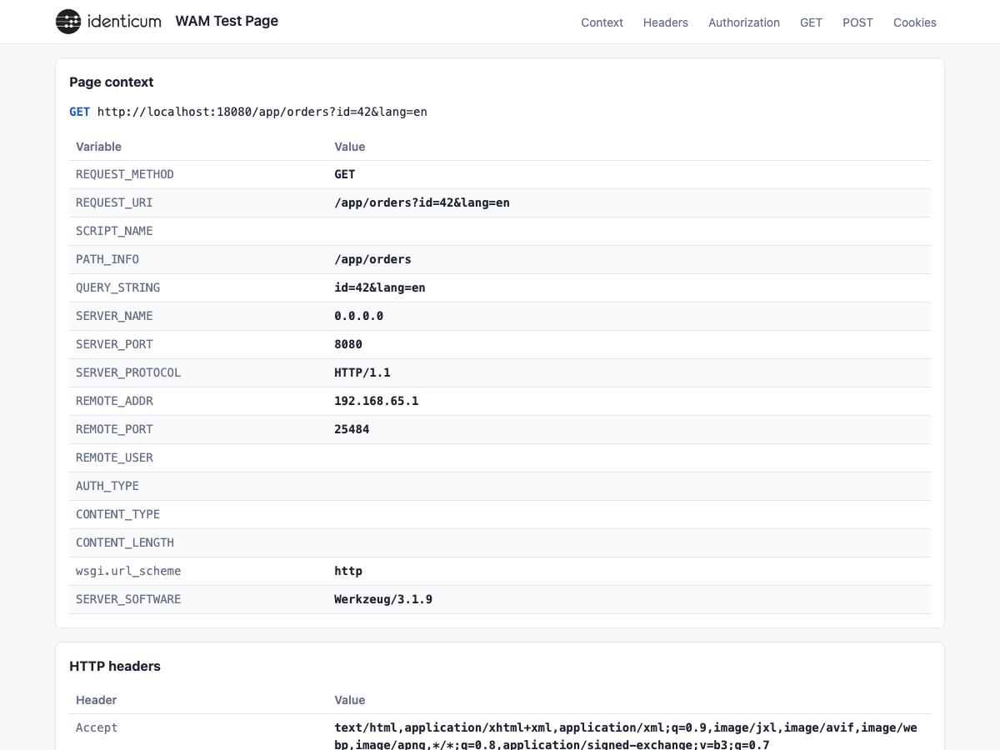

# wam-test-page

A minimal web page that shows back every HTTP request it receives: headers, GET and POST parameters, the request body, cookies, the `Authorization` header and CGI-style server variables.

We use it in Identity and Access Management (IAM) projects to troubleshoot web access management (WAM) setups. Put it behind a reverse proxy, an identity-aware proxy such as [IPAx](https://github.com/Identicum/ipax), or an access gateway in front of Keycloak, Gluu/Janssen or another IdP. It then shows exactly what the protected application receives. Typical questions it answers:

- Is the proxy injecting the expected identity headers (for example `X-User`, `X-Email`, `X-Groups`, or an ID or access token)?
- Is the `Authorization` header forwarded, replaced or stripped? For `Basic` credentials the page shows the decoded username and password. For `Bearer` JWTs it shows the decoded header and claims.
- Do `X-Forwarded-For`, `X-Forwarded-Proto` and `X-Forwarded-Host` carry the right values, so the app builds correct redirect URLs?
- Are the path, query string and form parameters passed through unchanged after the proxy rewrites them?
- Which host, port, protocol and remote address does the backend see?

It is shipped as a container image:

```sh
docker pull ghcr.io/identicum/wam-test-page:latest
```



## What it shows

The page answers on **every path** (`/`, `/app/orders`, …) and for every method (`GET`, `POST`, `PUT`, `PATCH`, `DELETE`, `OPTIONS`, `HEAD`). That way it can stand in for any backend location.

| Section              | Content                                                                                       |
|----------------------|-----------------------------------------------------------------------------------------------|
| Page context         | Method and full URL, plus `REQUEST_URI`, `PATH_INFO`, `QUERY_STRING`, `REMOTE_ADDR`, `SERVER_NAME`, `SERVER_PORT`, `wsgi.url_scheme`, etc. |
| HTTP headers         | All request headers, sorted by name. Any header whose value is a JWT (such as `X-Id-Token`) is also shown decoded |
| Authorization        | Raw value and scheme. `Basic` shows the decoded username and password; a `Bearer` JWT shows its header, claims and `exp`/`iat`/`nbf`/`auth_time` as dates |
| GET parameters       | Query string parameters; repeated keys show every value                                       |
| POST parameters      | Form fields, uploaded file names, and the raw body for non-form requests (JSON is pretty-printed) |
| Cookies              | Parsed request cookies                                                                        |

JWTs are decoded only. Their signatures are **not** verified.

When the request prefers JSON (`Accept: application/json`), the same data is returned as JSON instead of HTML. This is handy for scripts and test automation.

## Run as a Docker container

```sh
docker compose up -d
```

or without compose:

```sh
docker run -d --name wtp -p 80:5000 ghcr.io/identicum/wam-test-page:latest
```

The page is served at http://localhost.

| Variable    | Default | Description                                                                     |
|-------------|---------|---------------------------------------------------------------------------------|
| `LOG_LEVEL` | `INFO`  | `DEBUG` logs one line per request; `TRACE` also logs the full captured data as JSON |

`GET /health` is reserved for the container health check and returns `OK`.

## Test

Open http://localhost in a browser, or make a curl call to get a JSON response:

```sh
curl -H "Accept: application/json" "http://localhost/some/path?foo=bar"
```

To simulate headers injected by a proxy:

```sh
curl -H "Accept: application/json" \
     -H "X-User: jdoe" \
     -H "X-Forwarded-Proto: https" \
     -u jdoe:secret \
     http://localhost
```

## Use behind a reverse proxy

Point the upstream of the location you want to inspect at the container. For example, with NGINX/OpenResty:

```nginx
location / {
    proxy_pass http://wtp:5000;
    proxy_set_header X-User $remote_user;
}
```

Then browse through the proxy and compare what you configured with what the page displays.

> **Security note:** the page shows every header, token and credential it receives, including decoded passwords. Use it only in development, test or troubleshooting environments, and never leave it exposed in production.

## Development

The app is a single Flask module, [app/main.py](app/main.py), with one Jinja template, [app/templates/index.html](app/templates/index.html). The page has no external CSS or JavaScript, so it also works where there is no internet access. Static files are served under `/_wtp/static/`, so they don't hide real paths you want to inspect.

To work on it with live reload, mount the code and turn on Flask's debug mode:

```sh
docker run --rm -p 80:5000 -e FLASK_DEBUG=1 -e LOG_LEVEL=DEBUG \
  -v ./app:/app ghcr.io/identicum/wam-test-page:latest
```

## Container image

The image is built from [Dockerfile](Dockerfile) on top of [ghcr.io/identicum/python-flask](https://github.com/Identicum/docker-base-images/tree/main/python-flask), for `linux/amd64` and `linux/arm64`. It listens on port 5000 (the base image default); the examples above map it to port 80 on the host. To trust a custom CA, mount it under `/usr/local/share/ca-certificates/` as described in the base image README.

The [docker workflow](.github/workflows/docker.yml) builds and publishes the image to GHCR when `app/` or `Dockerfile` change on `main`, or when the workflow is run manually. It uses the shared [docker-build-autotag](https://github.com/Identicum/github-actions/blob/main/.github/workflows/docker-build-autotag.yml) workflow, which tags each build as `latest` and with the build date (`YYYYMMDD`).

Image `20261104` is the last one based on the former Java/Tomcat (JSP) implementation.
